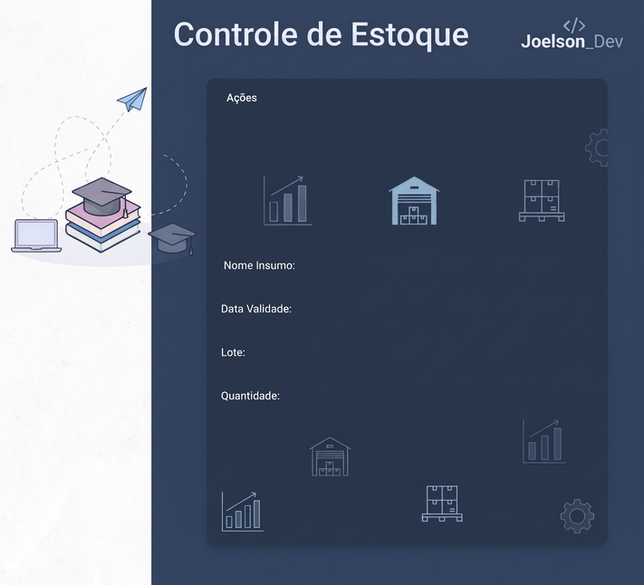
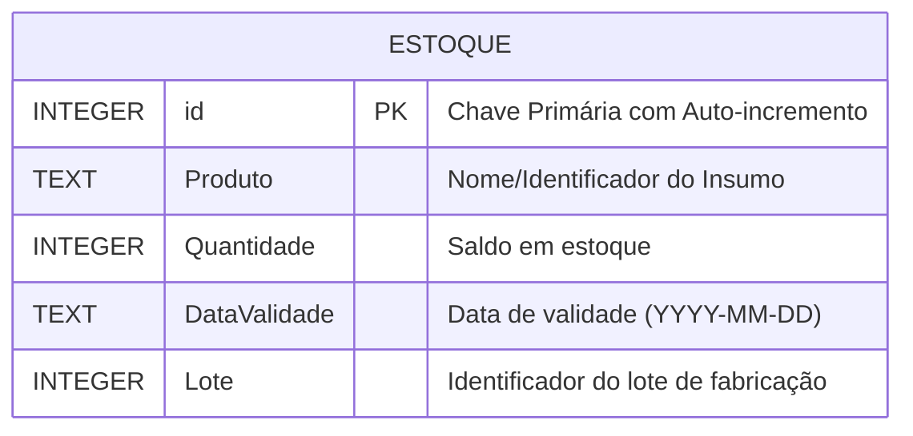

# 📦 Sistema de Controle de Estoque de Insumos

<div align="center">


<p align="center">
  <b>Aplicação desktop robusta e intuitiva para gerenciamento, rastreamento de lotes e controle de validade de insumos industriais e comerciais.</b>
</p>

[Visão Geral](#-sobre-o-projeto) •
[Funcionalidades](#-funcionalidades) •
[Arquitetura](#-arquitetura-e-banco-de-dados) •
[Estrutura](#-estrutura-do-projeto) •
[Como Executar](#-como-executar) •
[Boas Práticas](#-boas-práticas-de-engenharia) •
[Roadmap](#-próximas-melhorias) •
[Autor](#-autor)

</div>

---

## 📌 Sobre o Projeto

O **Sistema de Controle de Estoque** foi desenvolvido para solucionar desafios cotidianos de controle de suprimentos em ambientes produtivos, estoques e almoxarifados. 

Muitas empresas e processos sofrem com a falta de rastreabilidade de **lotes** e perdas financeiras por **vencimento de insumos**. Esta aplicação oferece uma interface gráfica moderna e fluida, integrada diretamente a um banco de dados relacional embarcado (**SQLite**), permitindo controle preciso de entradas, saídas e consultas rápidas sem exigir configurações complexas de infraestrutura.

---

## 📸 Interface do Aplicativo

<div align="center">
  
  <p><i>Layout estilizado desenvolvido com foco em usabilidade e agilidade operacional.</i></p>
</div>

---

## 🚀 Funcionalidades

- **➕ Entrada de Insumos (Adicionar)**: Registra novos suprimentos no sistema com nome, quantidade disponível, data de validade e número de lote.
- **📉 Baixa de Estoque (Consumir)**: Realiza a dedução precisa da quantidade consumida para um lote e insumo específicos, garantindo rastreabilidade unitária.
- **🔍 Consulta de Insumos (Visualizar)**: Pesquisa e exibe em tempo real o histórico completo de lotes cadastrados, validades e saldo atual em estoque.
- **🗑️ Remoção de Registros (Deletar)**: Permite a exclusão de itens ou lotes descontinuados.
- **💬 Painel de Feedback ao Usuário**: Terminal visual integrado na interface que confirma o sucesso ou detalha eventuais inconsistências em cada operação.

---

## 🗄️ Arquitetura e Banco de Dados

A camada de persistência utiliza **SQLite 3**, garantindo que os dados sejam armazenados de forma confiável localmente em um único arquivo (`Estoque.db`), sem dependência de servidores de banco externos.

### Diagrama Entidade-Relacionamento (ERD)



### Inicialização Automática

Ao iniciar a aplicação, a tabela é criada automaticamente via DDL caso ainda não exista:

```sql
CREATE TABLE IF NOT EXISTS Estoque (
    id INTEGER PRIMARY KEY AUTOINCREMENT,
    Produto TEXT NOT NULL,
    Quantidade INTEGER,
    DataValidade TEXT,
    Lote INTEGER
);
```

---

## 📁 Estrutura do Projeto

```text
Controle_de_estoque/
│
├── main.py                 # Ponto de entrada principal da aplicação
├── Estoque.db              # Banco de dados local SQLite (gerado/mantido pela aplicação)
├── requirements.txt        # Informações sobre dependências e ambiente
├── .gitignore              # Arquivos e diretórios ignorados pelo Git
├── README.md               # Documentação completa do projeto
│
└── janela/                 # Módulo de interface gráfica e recursos visuais
    ├── window.py           # Lógica da interface Tkinter e integração com o banco
    ├── fundo_img.png       # Imagem de plano de fundo da aplicação
    ├── background.png      # Arte complementar de layout
    ├── img0.png            # Botão: Visualizar Insumo
    ├── img1.png            # Botão: Deletar Insumo
    ├── img2.png            # Botão: Consumir Insumo
    ├── img3.png            # Botão: Adicionar Insumo
    ├── img_textBox0.png    # Background da caixa de saída de dados
    ├── img_textBox1.png    # Background do campo 'Nome do Insumo'
    ├── img_textBox2.png    # Background do campo 'Data de Validade'
    ├── img_textBox3.png    # Background do campo 'Lote'
    └── img_textBox4.png    # Background do campo 'Quantidade'
```

---

## 🛠️ Tecnologias Utilizadas

- **[Python](https://www.python.org/) (versão 3.8+)**: Linguagem central da aplicação.
- **[Tkinter](https://docs.python.org/3/library/tkinter.html)**: Framework padrão para construção da Interface Gráfica (GUI) nativa.
- **[SQLite3](https://docs.python.org/3/library/sqlite3.html)**: Motor de banco de dados SQL ACID embarcado.
- **[Pathlib](https://docs.python.org/3/library/pathlib.html)**: Gerenciamento agnóstico e seguro de diretórios no sistema operacional.

---

## 💻 Como Executar o Projeto

### Pré-requisitos

- Ter o **Python 3.8 ou superior** instalado em sua máquina.
- Como o projeto utiliza **módulos padrão da biblioteca Python** (`tkinter`, `sqlite3`, `pathlib`), **não é necessário instalar pacotes externos via pip**.

> **Nota para distribuições Linux (Ubuntu/Debian):** Caso o suporte ao Tkinter não esteja ativo por padrão, instale executando:
> ```bash
> sudo apt update && sudo apt install python3-tk
> ```

### Passo a Passo

1. **Clone este repositório:**
   ```bash
   git clone https://github.com/SEU_USUARIO/controle-de-estoque-python.git
   ```

2. **Acesse o diretório do projeto:**
   ```bash
   cd controle-de-estoque-python
   ```

3. **Inicie a aplicação:**
   ```bash
   python main.py
   ```
   *(Ou execute `python janela/window.py`)*

---

## 🛡️ Boas Práticas de Engenharia Implementadas

- **Proteção contra SQL Injection**: Consultas `SELECT`, `UPDATE` e `DELETE` implementadas através de **Prepared Statements** com tuplas de parâmetros (`?`), blindando a aplicação contra injeção de comandos maliciosos e tratando caracteres especiais com segurança.
- **Resolução Dinâmica de Diretórios**: Utilização de `pathlib.Path(__file__).resolve()` para localização do banco de dados e imagens, prevenindo falhas de `FileNotFoundError` causadas por diferentes diretórios de execução no terminal.
- **Validação de Entrada e Tipagem**: Tratamento de exceções com `try/except` ao manipular valores inteiros de quantidades e lotes, evitando crashes inesperados durante a operação.
- **Separação de Camadas e Assets**: Isolamento dos elementos estéticos e visuais na pasta `janela/`, mantendo a raiz limpa e organizada com ponto de entrada padronizado (`main.py`).

---

## 🔮 Próximas Melhorias (Roadmap)

- [ ] Implementação de **tabela interativa (Treeview)** para exibição tabular dos insumos cadastrados.
- [ ] Alertas visuais automáticos para **insumos com estoque abaixo da quantidade mínima** configurada.
- [ ] Indicador colorido para **produtos próximos ao vencimento**.
- [ ] Exportação de relatórios em **CSV / Excel** para auditoria.
- [ ] Modularização arquitetural em padrão **MVC (Model-View-Controller)**.

---

## 👤 Autor

Desenvolvido por **Samuel**.

Se este projeto foi útil para você ou serviu de inspiração, deixe uma ⭐️ no repositório!

[](https://linkedin.com)
[](https://github.com)

---

## 📄 Licença

Este projeto está sob a licença [MIT](https://opensource.org/licenses/MIT). Sinta-se livre para utilizar, modificar e distribuir para fins de estudo ou produção.
